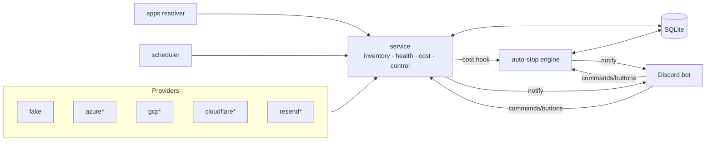

# cloud-control

Discovers cloud resources, checks their health, tracks month-to-date cost, and
lets the owner stop/start resources from a private Discord server, with budget
auto-stop.

**Status (v0.1 in progress):** core, Discord bot, scheduler and auto-stop run
end-to-end on the fake provider. Azure, GCP, Cloudflare and Resend providers
are not implemented yet.


<sub>* not implemented yet</sub>

## Apps

Resources are grouped into **apps** across providers (`apps:` in `config.yaml`):

- `match_tags`: every listed tag must match (keys are case-insensitive; good for Azure tags).
- `resources`: explicit full IDs or `provider/name`, for things you can't tag (R2 buckets, Resend domains, Vision).
- `alerts_channel_id`: health alerts and control echoes for this app go here; empty = global `#alerts`.
- `critical: true`: auto-stop never touches the app's resources.

Anything that matches no app shows up as `unassigned`. `/status`, `/resources`
and `/cost` take an `app` option. Budget and auto-stop messages always go to
the global `#alerts`.

## Setup

```bash
cp .env.example .env   # fill in the Discord IDs and bot token
go run ./cmd/cloud-control
```

The Discord bot needs the `applications.commands` and `bot` scopes, with
permission to send messages and embeds in the alert and digest channels.
Commands are registered to `DISCORD_GUILD_ID` on startup.

`dev.fake_provider: true` loads demo resources across two apps. To exercise
auto-stop, set a low `monthly_budget` (the demo spend is $4.20) and keep
`auto_stop.dry_run: true`.

## Commands

| Command | |
|---|---|
| `/ping` | latency, uptime, last polls |
| `/status [app] [refresh]` | resources by app with health |
| `/resources [provider] [app]` | short IDs, available actions, 🛡️ critical |
| `/cost [app] [refresh]` | MTD/forecast per provider and per app |
| `/stop`, `/start <resource>` | autocomplete → confirm within 60s → audited |
| `/audit [n]` | recent actions |
| `/autostop on\|off\|status` | runtime override, persisted |

All interactions are owner-only and must come from the configured guild.

## Auto-stop notes

- Triggers only on complete MTD actual spend. If any provider's cost fetch fails, the total counts as unknown and nothing triggers.
- Runs at most once per month. A cancel, or a finished dry run, blocks it for the rest of the month; `/autostop on` clears that. Turning it off cancels a pending run.
- Pending grace timers are stored in SQLite and resume on restart. A run interrupted mid-execution resumes too; resources that are already stopped are skipped.

## Tests

```bash
go test ./...
```
